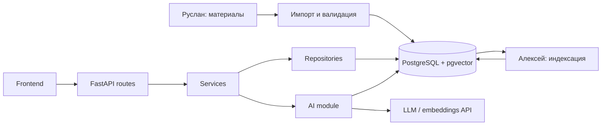

# IGNIS 0G — Backend Architecture

**Статус:** предлагаемый контракт MVP v0.1 · 14.11.2026  
**Горизонт:** двухдневный хакатон.  
**Цель:** каталог исследований горения в микрогравитации, научные выводы и данные с источниками, контекстный AI-ассистент; Nexus и сравнение — расширение после рабочего MVP.

## 1. Scope и критерии готовности

| Приоритет | Функциональность | Критерий |
|---|---|---|
| P0 | Импорт | Повторная загрузка пакета не дублирует записи; ошибки валидации видны до записи |
| P0 | Каталог | Поиск, фильтр по категории/тегу, стабильная пагинация |
| P0 | Страница исследования | Обзор, условия, выводы, источники, медиа, метаданные графиков |
| P0 | Данные | Хотя бы один реальный набор данных, если удалось получить проверяемый источник; иначе честное пустое состояние |
| P0 | RAG | Ответ на вопрос по открытому исследованию или всему каталогу с проверяемыми ссылками |
| P0 | Безопасность | Подтвержденные выводы о пожарной безопасности, отделенные от рекомендаций и гипотез |
| P0 | Надежность | Healthcheck, CORS, таймауты, единый формат ошибок, проверка интеграции |
| P1 | Nexus | Граф заранее проверенных связей |
| P1 | Compare | Сопоставление исследований с ограничениями сравнимости |
| P2 | Streaming / автоматические связи | Только после рабочего P0, без блокирования демо |

Не входят: авторизация и персональные аккаунты, серверная история чатов, админ-панель, физическая симуляция, отдельная графовая БД, микросервисы, динамический веб-поиск во время ответа. Подготовка FLEX, BASS, ACME и других исследований зависит от фактически полученных источников.

## 2. Архитектура

Модульный монолит: FastAPI + Pydantic v2 + SQLAlchemy 2.x (async) + asyncpg + Alembic + PostgreSQL/pgvector. Uvicorn, uv, Docker. Frontend: Vite + React + TypeScript + shadcn/ui. Cloudflare Tunnel для доступа к развернутому API.



Запрос каталога: route → service → repository → PostgreSQL → response schema. Запрос чата: route → проверка контекста/лимитов → AI service → retrieval → LLM → проверка ссылок → response schema. Соединения с БД не удерживать во время сетевого вызова LLM; retrieval заканчивается до генерации.

```text
backend/
  app/
    main.py
    api/
      router.py
      dependencies.py
      routes/{studies,catalog,assistant,nexus,health}.py
    core/{config,database,errors}.py
    models/
    schemas/{study,source,assistant,nexus,common,ingestion}.py
    repositories/
    services/
    ai/{service,retrieval,embeddings,ingestion,prompts,llm}.py
  scripts/{import_studies,index_sources}.py
  data/seed/
  migrations/
  tests/
  pyproject.toml
  Dockerfile
  .env.example
```

Роутеры не содержат SQL или промптов. Repository — функция запросов к БД, service — бизнес-правила. Не создавать абстрактный repository для каждой модели без необходимости. Общие Pydantic-схемы — единственный контракт между API и AI. Все изменения схем БД проходят через Alembic, не через `create_all()` на старте сервера.

## 3. Данные и схема БД

Внутренние первичные ключи — UUID, публичный идентификатор исследования — уникальный стабильный `slug` (например, `flex`). В API поле `study_id` содержит slug, а идентификаторы источников, наборов данных и связей — UUID в виде строк. Все таблицы имеют UUID `id` PK. Время — UTC.

| Таблица | Поля (кроме id) | Ограничения и примечания |
|---|---|---|
| studies | slug, title, description, methodology, category, tags TEXT[], conditions JSONB, thumbnail_url | slug UNIQUE NOT NULL; title, description, category NOT NULL; tags по умолчанию []; conditions {} |
| sources | study_id, source_key, title, url, source_type, text_content, content_hash, indexed_hash | FK studies; UNIQUE(study_id, source_key); title, url, source_type NOT NULL; текст, хеши nullable до загрузки/индексации |
| findings | study_id, source_id, finding_key, claim, evidence, locator, safety_impact | UNIQUE(study_id, finding_key); claim/evidence обязательны, safety_impact и locator nullable |
| datasets | study_id, source_id, dataset_key, title, chart_type, data JSONB, units JSONB, locator, notes | UNIQUE(study_id, dataset_key); source_id обязателен; chart_type line/scatter/bar; data/units обязательны |
| media | study_id, source_id, media_key, media_type, url, caption | UNIQUE(study_id, media_key); image/video/link; source_id обязателен |
| relations | from_study_id, to_study_id, source_id, relation_type, explanation, evidence JSONB, verified BOOLEAN | UNIQUE(from_study_id,to_study_id,relation_type); разные исследования; verified=false по умолчанию |
| chunks | source_id, chunk_index, content, metadata JSONB, embedding VECTOR(D) | UNIQUE(source_id,chunk_index); embedding и content обязательны для опубликованных чанков |

FK для зависимых объектов — NOT NULL, если не указано обратное. Для findings/datasets/media источник обязан принадлежать указанному исследованию: проверять в импортере и, по возможности, составным FK `(source_id,study_id)` → `sources(id,study_id)` с соответствующим UNIQUE. Для relations источник должен относиться хотя бы к одному из двух исследований; это правило проверяется импортом. Источник общего отчета при необходимости заводится отдельно в каждом исследовании. Удаление в MVP не предоставляется; каскадное удаление chunks при удалении source допустимо.

Индексы: уникальные ключи выше, FK-колонки, studies(category), GIN tags. Для небольшого каталога поиск через ILIKE, векторный поиск точный по cosine distance (`<=>`) без ANN. HNSW/FTS — только при установленной необходимости. `CREATE EXTENSION IF NOT EXISTS vector` перед созданием chunks; D задается в миграции после согласования модели эмбеддингов. Все вектора одной модели и размерности.

```mermaid
erDiagram
    STUDIES ||--o{ SOURCES : has
    STUDIES ||--o{ FINDINGS : has
    STUDIES ||--o{ DATASETS : has
    STUDIES ||--o{ MEDIA : has
    SOURCES ||--o{ FINDINGS : supports
    SOURCES ||--o{ DATASETS : provides
    SOURCES ||--o{ MEDIA : provides
    SOURCES ||--o{ CHUNKS : split_into
    STUDIES ||--o{ RELATIONS : from
    STUDIES ||--o{ RELATIONS : to
    SOURCES ||--o{ RELATIONS : supports
```

## 4. Импорт и индексирование

Руслан передает локальный JSON-пакет по формату из API_SPEC.md и очищенный текст источников (в JSON `text_content`; PDF можно хранить отдельно для проверки). Импортер валидирует Pydantic и ссылки, делает upsert по стабильным ключам в транзакции. Отсутствующая в новом пакете запись не удаляется автоматически. Пакеты не являются публичным HTTP API. Не публиковать непроверенные числовые данные; `[]` означает отсутствие данных, не нулевое значение.

```bash
uv run alembic upgrade head
uv run python -m scripts.import_studies data/seed/studies.json
uv run python -m scripts.index_sources
uv run uvicorn app.main:app --host 0.0.0.0 --port 8000
```

Это целевые команды, а не существующие скрипты. Индексация: источник с непустым текстом и новым хешем → чанки с locator (страница/раздел, если известны) → embeddings → атомарная замена всех chunks данного источника + запись indexed_hash. Устаревшие chunks не участвуют в retrieval (`indexed_hash = content_hash`); при сбое повторить индексацию. Изменение модели требует переиндексации всех источников и при необходимости миграции D.

## 5. Каталог и научные данные

- Поиск case-insensitive по title / tags / description / findings.claim (EXISTS, без дублирования строк). Параметризованные запросы; экранировать LIKE wildcard, если ищем буквальный текст. Категория и тег — точные фильтры.
- При непустом q ранжирование: совпадение в title > tags > description > findings; затем title и slug по возрастанию. Без q — title и slug. `total` учитывает фильтры до пагинации.
- Detail возвращает выводы, источники, медиа и только метаданные datasets одним запросом API. Числовые ряды грузятся отдельным endpoint. `safety_implications` формируется из findings с непустым safety_impact.
- Отсутствие optional данных — null или пустые массивы согласно контракту. Не подставлять демонстрационные значения под видом измерений NASA.
- Dataset: единые числовые точки x/y (null для пропущенного y), серии, оси и единицы, источник, указание происхождения/ограничений. Если извлечено из графика, явно отметить оцифровку и точность; оригинальные единицы сохранять, переводы документировать.

## 6. Интеграция с AI (граница ответственности)

Алексей владеет `app/ai/`. Общий импортируемый вход:

```python
# app/ai/service.py
from app.schemas.assistant import ChatRequest, ChatResponse

async def ask(request: ChatRequest) -> ChatResponse:
    ...
```

AI-модуль использует общий session factory из `app.core.database`, самостоятельно открывает и закрывает короткую сессию для retrieval; HTTP-слой не передает ORM-объекты. На время разработки существует мок `ask` того же типа. Если сравнение реализуется, согласуется аналогичный `compare(request: CompareRequest) -> CompareResponse`.

Пайплайн: embeddings запроса → поиск top-k (стартовое значение 6, подбирать на контрольных вопросах) → фильтр scope и актуальности индекса → сбор контекста с идентификаторами чанков → LLM → валидация структурированного ответа. История передается клиентом; максимум 12 сообщений. Пользовательский ввод/тексты источников — данные, не инструкции. Не выполнять инструменты или команды по тексту документов.

Ответ со статусом `answered` только при наличии достаточных источников. Цитаты создаются из реально возвращенных retrieval chunks, URL и заголовки берутся из БД, а не генерируются LLM. Проверка: ID чанка существует в retrieved set, источник соответствует чанку, scope соблюден; при невозможности подтвердить научный ответ вернуть `insufficient_evidence`. При недоступности инфраструктуры вернуть 503/504, не маскировать как отсутствие знаний. Related studies — существующие slug, основанные на retrieved evidence. В `global` study_id является подсказкой контекста, в `study` жестким фильтром. По умолчанию scope=study при наличии study_id, иначе global (нормализация в schema/service).

## 7. Nexus и сравнение (P1)

Nexus использует только `verified=true` связи: supports, contradicts, complements, similar. Подтверждение/противоречие требует конкретного объяснения, сопоставимого вывода и источника. Даже если связь предложена AI, до проверки она не публикуется. При обходе считать связи в обе стороны, сохранять исходное направление edge. Глубина 1–2, ограничение 50 узлов, deterministic BFS по slug/ID, `truncated` при отсечении. Без study_id — ограниченный общий граф.

Compare: 2–3 исследования из каталога; общие закономерности, различия, ограничения, ссылки. Численные сопоставления только для совместимых единиц, методики, условий и измеряемой величины. При несопоставимости — качественное сравнение с явным предупреждением. Не превращать научные наблюдения в сертифицированные рекомендации по безопасности.

## 8. Эксплуатация и ошибки

- `/health` проверяет процесс и доступность БД (`SELECT 1`, короткий timeout), не делает платный вызов LLM.
- CORS: явный список frontend origins; `.env` не коммитить. `DATABASE_URL`, `LLM_API_KEY`, `LLM_MODEL`, `EMBEDDING_MODEL`, `EMBEDDING_DIM`, `CORS_ORIGINS`, `AI_TIMEOUT_SECONDS` (начальное значение 45), `AI_MAX_CONCURRENCY` (начальное значение 2). Названия provider-specific переменных согласовать с Алексеем.
- Публичный чат: ограничение длины и тела запроса (например 32 KiB), rate limit (например 5 запросов/мин на клиента) и лимит параллельных генераций. Для демо допустим один worker с in-memory ограничителем; за trusted proxy использовать только проверенные заголовки, иначе IP сокета. При нескольких workers нужен общий limiter или ограничение на edge. Не считать CORS защитой от злоупотребления.
- Все ошибки в формате API_SPEC.md. Переопределить handlers для HTTPException, RequestValidationError и непредвиденных ошибок; request_id передавать в заголовке и логах. Не логировать ключи, полные промпты и историю. Таймауты вызовов LLM и БД; отмена по возможности.
- API доступен через туннель, БД не публикуется в интернет; соединение по внутренней сети/закрытому доступу. Сервисный пользователь БД без superuser. Ключи у backend, не в Vite.

## 9. Командные границы

| Участник | Артефакт / обязательство |
|---|---|
| Техлид / backend | Общие schemas, модели, миграции, импорт, роутеры, mock AI, интеграционные тесты |
| Алексей | Индексация, retrieval, ask, ссылки, 10–15 проверочных вопросов; согласует D и модель |
| Руслан | JSON по контракту, оригинальные источники, проверка чисел, единиц и выводов |
| Адлет | PostgreSQL+pgvector, закрытая сеть, секреты, деплой, Tunnel, проверка health |
| Кирилл П. | Клиент API, типы, UI каталога и страниц, чат, обработка пустых состояний/ошибок |
| Кирилл Е. | Демо, презентация, сценарий и итоговое тестирование |

## 10. Порядок реализации

1. Зафиксировать API_SPEC и общие схемы; запустить `GET /studies`, `GET /studies/{study_id}`, `GET /health`, `POST /assistant/chat` с моками. У фронта сразу появляются `/docs` и `/openapi.json`.
2. Модели + миграции + импорт одного исследования; проверить повторный импорт и FK. Затем подключить реальную БД вместо моков каталога. Деплой skeleton параллельно.
3. Алексей индексирует тот же источник; заменить mock ask реальной функцией; протестировать обычный вопрос, недостаток доказательств и недоступность LLM.
4. Реализовать графики, остальные материалы и научные выводы из реальных источников. Smoke-test: frontend → catalog → study → dataset → chat + цитата.
5. Только затем Nexus/Compare, polish, демонстрация и фиксация стабильной версии.

**Definition of done P0:** миграции на чистой БД; идемпотентный импорт; API совпадает с OpenAPI; проверены 404, 422, пустые результаты, 503/504; чат не выдумывает источники; UI работает через публичный backend. Если числовые данные недоступны, явно сообщить это и не считать демонстрацию реальных графиков выполненной.

## 11. Открытые решения перед реализацией

- Алексей: провайдер LLM, модель эмбеддингов, D; формат locator для PDF; фактическая реализация ask.
- Руслан: доступность исходных рядов и текста, категории/теги, источники, допустимость использования медиа.
- Адлет: URL и режим доступа БД, origins, настройки туннеля и лимитов.
- Команда: подтвердить P1 и scope. Настоящий документ — проектное решение, код и инфраструктура здесь не проверены.
